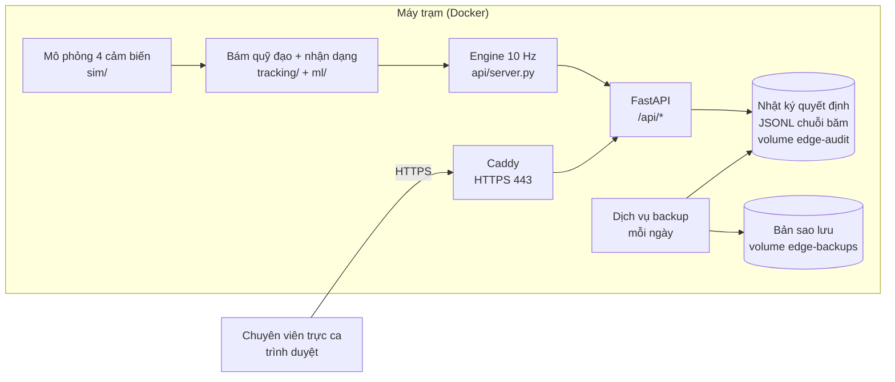
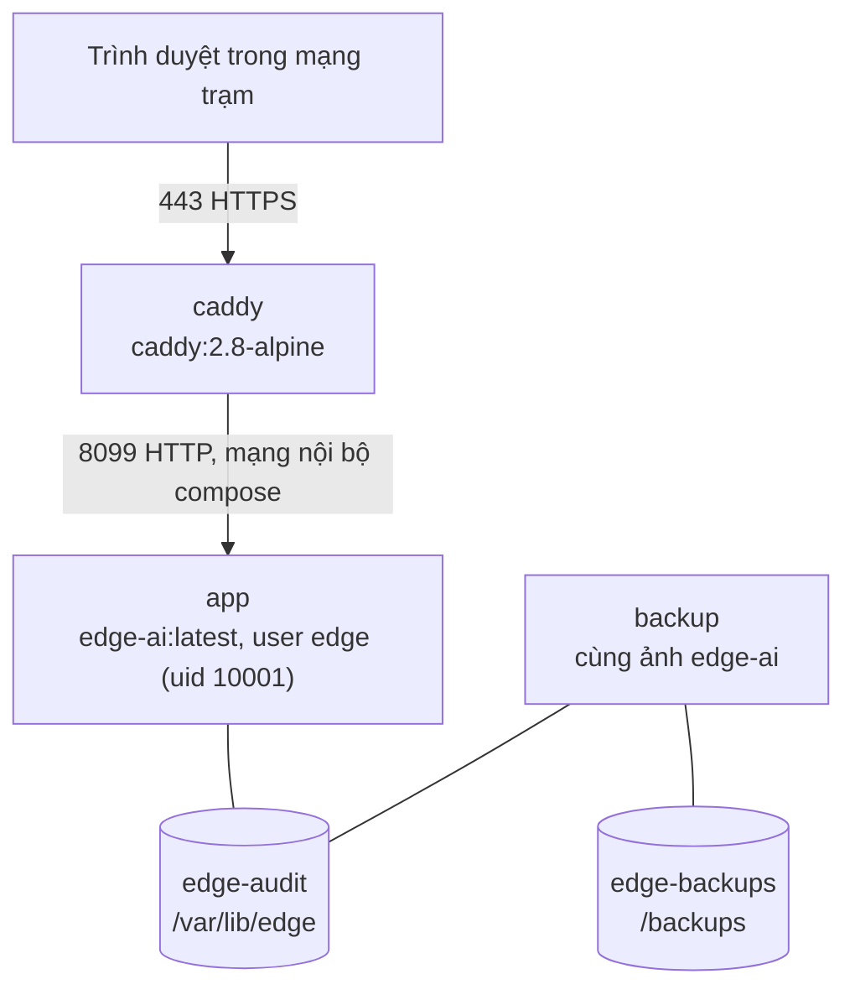

# Kiến trúc hệ thống — Edge AI (bước 2)

> Tài liệu này mô tả **cái đã xây**, viết lại cho rõ sau khi làm. Yêu cầu gốc
> nằm ở [PRD.md](PRD.md). Quy ước mã nằm ở [CONVENTIONS.md](CONVENTIONS.md).
> Cập nhật: 22/11/2026.

## 1. Bức tranh tổng thể

Mọi thứ chạy trên **một máy** đặt tại trạm. Không có cloud, không có dịch vụ
bên ngoài, không có cơ sở dữ liệu.

**Luồng một khung (100 ms):**
1. Mô phỏng sinh số đo của radar, RF, EO/IR, LiDAR, kèm báo động giả.
2. Bộ bám nhiều mục tiêu ghép số đo vào vết bám:
   - GNN (thuật toán Hungary) với cổng χ² 99,9%;
   - quản lý vết theo luật M-of-N.
3. Với vết đã xác nhận, chạy các mạng học sâu, tối đa **2 ảnh phổ + 1 đoạn
   I/Q mỗi khung**, ưu tiên vết còn mơ hồ:
   - CNN micro-Doppler;
   - CNN RF (STFT).
4. Hợp nhất nhận dạng theo độ tin cậy từng cảm biến. Phát hiện mâu thuẫn, ví
   dụ camera bị nhãn ngụy trang đánh lừa.
5. Khi mất dấu: EKF dự đoán tiếp, Transformer sửa sai số dự đoán.
6. Đưa lên dashboard. **Người** xác nhận hoặc bỏ qua, và mỗi quyết định ghi
   đúng một dòng vào nhật ký chuỗi băm.

**Ranh giới đạo đức (cứng):** không có đường nào từ hệ thống ra khí tài. API
chỉ có xem, xác nhận/bỏ qua và đổi kịch bản (PRD A-12).

## 2. Các khối và trách nhiệm

| Khối | Thư mục | Làm gì | Chạy trên trạm? |
|---|---|---|---|
| Mô phỏng | `backend/edge_ai/sim/` | Quỹ đạo 3D, thời tiết, mô hình đo 4 cảm biến, I/Q, micro-Doppler | Có |
| Mạng nơ-ron | `backend/edge_ai/ml/` | MicroDopplerNet, RF STFT+CNN, TrajTransformer | Có (chỉ suy luận) |
| Bám quỹ đạo | `backend/edge_ai/tracking/` | EKF, hợp nhất nhận dạng, bám nhiều mục tiêu | Có |
| Máy chủ | `backend/edge_ai/api/` | Vòng 10 Hz, REST API, xác thực, nhật ký, sao lưu | Có |
| Đánh giá | `backend/edge_ai/experiments/` | Đo độ chính xác, độ trễ, vẽ hình | Không |
| Huấn luyện | `backend/edge_ai/training/` | Huấn luyện lại trọng số | Không |
| Giao diện | `frontend/index.html` | Dashboard một trang, HTML/JS thuần | Trình duyệt |
| Triển khai | `deploy/` | Dockerfile, compose (app, backup, caddy), Caddyfile | — |

**Quy tắc phụ thuộc** (có test tự động bảo vệ: `test_quy_tac_phu_thuoc_giua_cac_goi`):
- Mã chạy trên trạm (`api`, `tracking`, `sim`, `ml`) **không** được import
  `experiments` hay `training`.
- `sim` và `ml` không được biết `tracking`.

Nhờ vậy ảnh Docker không kéo theo mã huấn luyện.

## 3. Lựa chọn công nghệ và lý do

| Chọn | Thay vì | Lý do |
|---|---|---|
| Python + PyTorch (CPU) | C++ / TensorRT | Khoá luận cần đổi nhanh. Mạng đủ nhỏ (< 1 MB) để CPU chạy kịp 50 ms. TensorRT để dành khi lên Jetson (MAINTENANCE.md) |
| FastAPI + uvicorn | Flask, Django | Nhẹ, có kiểm tra đầu vào (pydantic) sẵn, tài liệu API tự sinh |
| HTML/JS thuần, không build | React, Vue | Một màn hình, một người dùng; không cần Node trên trạm, không có bước build có thể hỏng |
| Thăm dò `/api/state` mỗi ~180 ms | WebSocket | Đơn giản, qua proxy dễ, tự hồi phục khi mất mạng; 10 Hz là đủ cho mắt người |
| Tệp JSONL chuỗi băm | PostgreSQL / SQLite | Chỉ có **một** loại dữ liệu cần lưu bền (nhật ký quyết định), ghi nối đuôi, vài chục dòng mỗi ca. Tệp văn bản dễ kiểm tra, dễ sao lưu, và chuỗi băm làm lộ mọi lần sửa. Xem DATA.md |
| Docker Compose | Kubernetes, cài tay | Một máy, một lệnh `up`; khởi động lại tự động; cô lập quyền |
| Caddy | Nginx + certbot | HTTPS tự động (kể cả CA nội bộ cho `localhost`), cấu hình 20 dòng |
| Mã truy cập dùng chung | Tài khoản riêng | Chủ dự án đã chốt (PRD Q-3); tài khoản riêng là L-3 |

## 4. Mô hình triển khai

- Cổng 8099 của `app` **không** mở ra ngoài; chỉ Caddy nhận kết nối.
- `app` và `backup` dùng chung ảnh, chạy bằng user không phải root.
- Chi tiết vận hành ở [DEPLOY.md](DEPLOY.md).

## 5. Những giới hạn kiến trúc đã biết

- **Một tiến trình, một máy.** Engine giữ trạng thái trong RAM. Không chạy
  được nhiều bản `app` song song; với 1 trạm thì không cần.
- **Dữ liệu cảm biến là mô phỏng.** Muốn nối cảm biến thật, phải thay `sim/`
  bằng một khối đọc thiết bị có cùng giao diện (`sense_all`).
- **Chưa đo trên Jetson** (PRD A-13, đã chấp nhận).
- **GNN** chưa xử lý tốt hai quỹ đạo cắt nhau trong cùng ô phân giải (cần
  JPDA/MHT).
