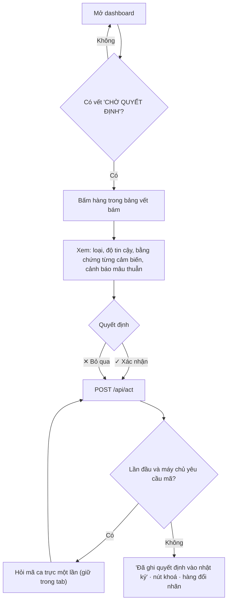

# Giao diện và luồng thao tác — Edge AI (bước 4)

> Mô tả dashboard **đã xây** (`frontend/index.html`) và các trạng thái đã
> kiểm thử trên trình duyệt ngày 22/11/2026. Người dùng chính: chuyên viên
> trực ca (PRD mục 2). Chỉ dùng trên màn hình máy tính (PRD Q-6).

## 1. Một màn hình, hai cột

```
┌──────────────────────────────────────────────────────────────────────────┐
│ EDGE AI · GIÁM SÁT   [● đang chạy] [kịch bản] [thời tiết]  ⚠ chỉ giám sát│
├──────────────────────────────────────────────────────────────────────────┤
│ (băng cảnh báo đỏ: thiếu trọng số / mất kết nối — chỉ hiện khi có lỗi)   │
├───────────────────────────────────┬──────────────────────────────────────┤
│ MẶT BẰNG HIỆN TRƯỜNG              │ CÁC VẾT BÁM (bấm để chọn)            │
│  vòng cự ly, quỹ đạo thật/bám,    │  ID · loại · cự ly · tin cậy ·       │
│  vùng nhìn camera, dự đoán khi    │  trạng thái (CHỜ QUYẾT ĐỊNH/…)       │
│  mất dấu                          ├──────────────────────────────────────┤
│                                   │ MỤC TIÊU ĐANG CHỌN                   │
│                                   │  xác suất từng loại, động học,       │
│                                   │  độ tin cậy vết bám                  │
├───────────────────────────────────┼──────────────────────────────────────┤
│ THỜI GIAN XỬ LÝ MỘT KHUNG         │ BẰNG CHỨNG THEO CẢM BIẾN             │
│  từng tầng so với ngân sách 50 ms │  radar · RF · EO/IR · LiDAR, mâu thuẫn│
│                                   ├──────────────────────────────────────┤
│                                   │ QUYẾT ĐỊNH CỦA NGƯỜI TRỰC CA         │
│                                   │  [✓ Xác nhận] [✕ Bỏ qua]             │
│                                   │  12 quyết định gần nhất              │
│                                   ├──────────────────────────────────────┤
│                                   │ KỊCH BẢN HIỆN TRƯỜNG (7 nút)         │
└───────────────────────────────────┴──────────────────────────────────────┘
```

Khi màn hình hẹp hơn 980 px, hai cột xếp thành một cột. Điện thoại không nằm
trong phạm vi (Q-6).

## 2. Luồng chính của người trực



Bảng vết bám **sắp theo ID**, không theo mức ưu tiên. Thứ tự ưu tiên đổi mỗi
khung, nên sắp theo nó thì hàng nhảy liên tục và người trực dễ bấm nhầm.

## 3. Các trạng thái và cách màn hình báo

| Trạng thái | Màn hình hiện gì | Nút quyết định | Đã kiểm thử |
|---|---|---|---|
| Đang kết nối (vừa mở) | `○ đang kết nối…` | — | Có |
| Bình thường | `● đang chạy` (xanh) | Mở nếu vết chưa có quyết định | Có (trình duyệt) |
| Chưa có vết bám (**trống**) | `● đang chạy — chưa có vết bám xác nhận`; bảng ghi "chưa có vết bám" | **Khoá** | Có |
| Vết đã có quyết định | Nhãn `ĐÃ XÁC NHẬN` / `ĐÃ BỎ QUA` | Khoá (máy chủ cũng chặn: 409) | Có |
| Mất dấu cảm biến | Lớp phủ vàng "MẤT DẤU — đang chạy dự đoán quỹ đạo", đường dự đoán nét đứt | Như bình thường | Logic: có test; giao diện: chưa xem trên trình duyệt |
| Nghi camera bị đánh lừa | Dòng mâu thuẫn dưới "Bằng chứng", vết chuyển `CHỜ QUYẾT ĐỊNH` | Mở | Logic: có test; giao diện: chưa xem trên trình duyệt |
| **Mất kết nối máy chủ** | `● mất kết nối máy chủ` (đỏ); băng đỏ "số liệu là của lần cập nhật cuối, KHÔNG dùng để ra quyết định"; toàn bộ bảng **mờ đi** | **Khoá** | Có (trình duyệt, 22/11) |
| Kết nối lại | Tự trở về bình thường, không cần tải lại trang | Mở lại | Có (trình duyệt) |
| Gửi quyết định lúc mất mạng | "Không ghi được quyết định: mất kết nối máy chủ — chưa có gì được ghi" | — | Có |
| Sai mã truy cập | "thiếu hoặc sai mã truy cập"; hỏi lại mã ở lần bấm sau | — | Có (test API) |
| Sai mã quá 5 lần | "sai mã quá nhiều lần, thử lại sau N giây" | — | Có (test API) |
| Máy chủ thiếu trọng số | Băng đỏ "trọng số CHƯA HUẤN LUYỆN — nhận dạng vô nghĩa" | Như bình thường | **Chưa** kiểm ở giao diện (máy chủ có test: thiếu trọng số thì dừng, trừ khi `EDGE_ALLOW_UNTRAINED=1`) |
| Không ghi được xuống đĩa | "Đã ghi trên màn hình nhưng KHÔNG ghi được xuống đĩa — báo kỹ thuật" (chữ đỏ) | — | **Chưa** kiểm thử (khó giả lập ổ đĩa hỏng) |

Ba dòng **mất kết nối**, **kết nối lại** và **gửi lúc mất mạng** được thêm
sau đợt kiểm thử đầu-cuối ngày 22/11/2026. Trước đó, khi mất kết nối, màn
hình vẫn hiện số liệu cũ như đang chạy, vẫn cho bấm, và báo lỗi bằng tiếng
Anh "Failed to fetch".

## 4. Nguyên tắc thiết kế đã áp dụng

- **Không tự quyết thay người.** Nút chỉ ghi quyết định của người. Không có
  nút nào gửi lệnh ra ngoài hệ thống.
- **Nói rõ khi không chắc.** Có độ tin cậy, bằng chứng từng cảm biến và cảnh
  báo mâu thuẫn, không chỉ một nhãn.
- **Báo lỗi bằng tiếng Việt và nói hậu quả**, ví dụ "chưa có gì được ghi",
  thay vì mã lỗi.
- **Ghi rõ giới hạn ngay trên màn hình**, ví dụ "đo trên CPU x86, không phải
  Jetson".
- Màu không phải kênh duy nhất: trạng thái luôn có chữ đi kèm (`ĐÃ XÁC NHẬN`,
  `CHỜ QUYẾT ĐỊNH`).

## 5. Chưa làm

- Phím tắt cho xác nhận và bỏ qua.
- Âm báo khi có vết mới chờ quyết định.
- Ô nhập tên ca trực: hiện mã ca là cố định `truc-ca-1` trong giao diện; tài
  khoản riêng là L-3.
- Kiểm tra trên trình duyệt khác Chrome/Edge.
